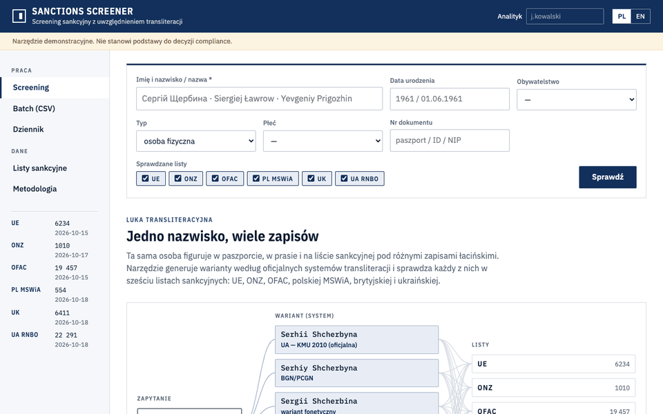
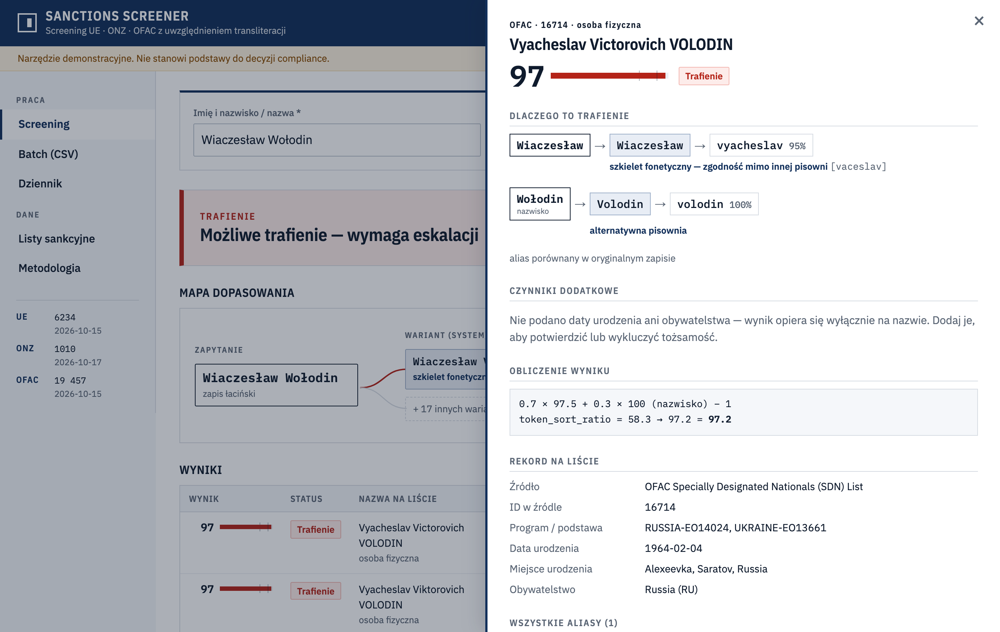
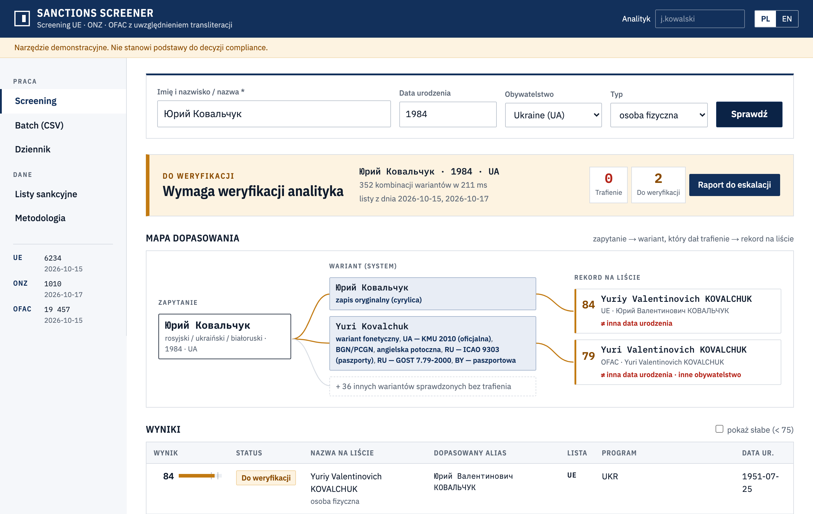
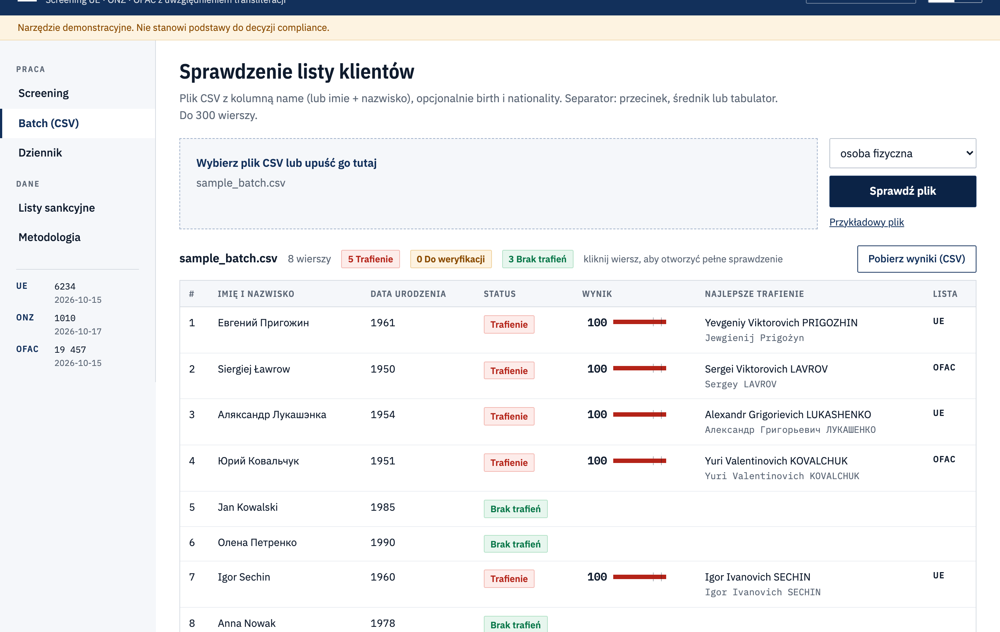
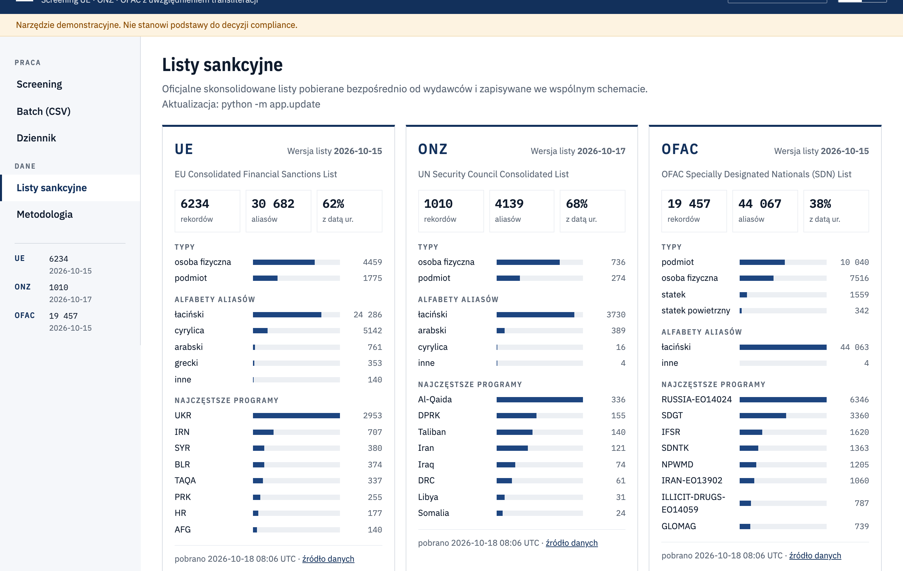
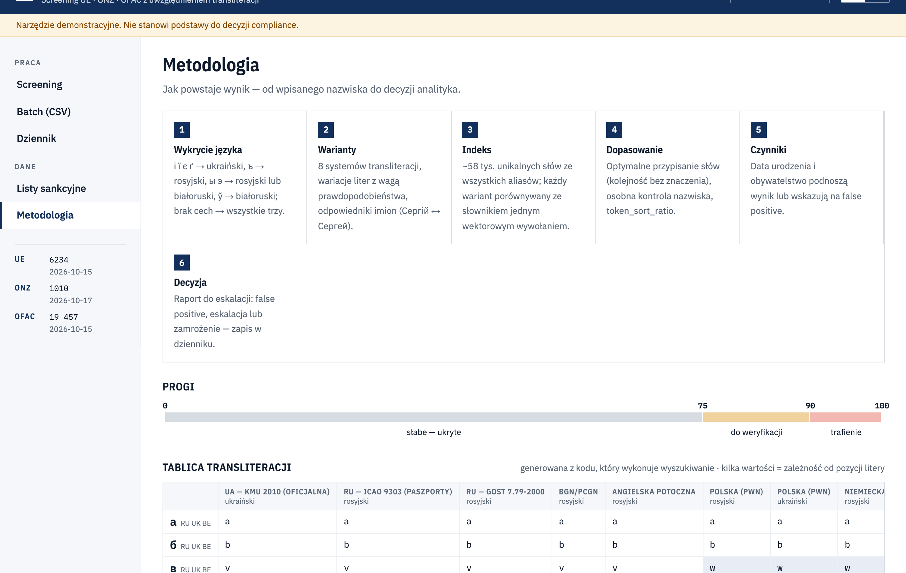

# Sanctions Screener: transliteration-aware name screening

Screens a person or company name against the official **EU**, **UN** and **OFAC** sanctions lists. It handles the main source of missed hits and false alerts for clients from Ukraine, Russia and Belarus: **one name can be spelled many different ways in Latin script.**



## The problem: the transliteration gap

`Сергій Щербина` can appear in documents, passports and sanctions lists as *Serhii Shcherbyna* (Ukrainian official system), *Serhiy Shcherbina* (BGN/PCGN), *Sergii*, *Sergiy*, *Siergiej Szczerbina* (Polish), *Sergej Schtscherbina* (German), or under the Russian form of the first name, *Sergey*.

A screener that only compares strings sees a different name each time. It either misses the hit or, with a loose threshold, raises alerts on half the customer base.

This matters in Poland in particular. Polish documents and press use **Polish transcription** (*Ławrow*, *Szojgu*, *Kadyrow*, *Wołodin*), while the lists use English spellings. In the measurements below, a naive fuzzy matcher scores *Wiaczesław Wołodin* at **61**: below any reasonable alert threshold, so the hit is missed. Its best "match" is a company called *Citadel Holding*. This tool scores it at **97** against *Vyacheslav VOLODIN* (OFAC).

## What it does

1. **Generates every plausible spelling** of the input name:
   - For Cyrillic input it detects the language from characteristic letters (`і ї є ґ` → Ukrainian, `ъ` → Russian, `ы э` → Russian or Belarusian, `ў` → Belarusian; ambiguous → all three).
   - It transliterates with eight named systems: **KMU 2010** (Ukrainian official), **ICAO 9303** (Russian passports), **GOST 7.79-2000**, **BGN/PCGN**, common English, **Polish (PWN)**, **German (Duden)** and the Belarusian passport system.
   - It adds a weighted beam search over letter-level alternatives (`и/й/ий → i/y/iy/ii/yi`, `х → kh/h/ch`, `щ → shch/sch/szcz`, …), pruned by plausibility.
   - It adds **equivalent given names** across languages (*Сергій ↔ Сергей*, *Олександр ↔ Александр ↔ Аляксандр*) and the Belarusian surname suffix `-енка ↔ -енко`.
   - For Latin input it removes diacritics and generates alternatives between spelling conventions (`sz ↔ sh`, `cz ↔ ch`, `w ↔ v`, Polish `c ↔ ts`, `-ij ↔ -iy ↔ -y`).
2. **Matches against all aliases** in all three lists, including the Cyrillic, Arabic and Greek ones. A *phonetic skeleton* catches spellings that no system produces.
3. **Scores and explains each hit.** The analyst sees which variant matched which alias, which system produced it, and how date of birth and nationality changed the score.

| Score | Status |
|---|---|
| ≥ 90 | **Trafienie / Possible match** |
| 75–89 | **Do weryfikacji / Review** |
| < 75 | weak, hidden by default |



Other features:

- **Match map.** For every search, a diagram shows *query → the variant that produced the hit (and which system generated it) → the list record*. Contradicting identifiers are flagged directly on the record.
- **Escalation report**: a printable page (or PDF) listing what was checked, when, against which list versions, the hits and their rationale, a system recommendation, and a decision form (*false positive / escalation / freeze*) that writes to the audit log. It follows the screening alert → review → decision workflow.
- **Batch screening** of a CSV customer list (comma, semicolon or tab separated), with a progress bar and CSV export.
- **Audit log** of every search, batch run and decision.
- **Lists page**: version, record and alias counts, scripts and top sanctions programmes for each source.
- **Methodology page**: the transliteration table (letter × system) is generated live from the same code that runs the search.
- **Telegram bot**: `/check Сергій Щербина 1975` returns the top 3 hits.
- Polish UI with an English switch.

| False positive argument | Batch |
|---|---|
|  |  |
| **Sanctions lists** | **Methodology** |
|  |  |

## Results on real list entries

From `python -m scripts.evaluate`. The baseline is a naive screener: unidecode, then the best rapidfuzz `token_sort_ratio` over all ~79k aliases.

| Query | This tool | Baseline | Hit |
|---|---:|---:|---|
| Евгений Пригожин, 1961 | **100** | 91 | Yevgeniy Viktorovich PRIGOZHIN (EU, OFAC) |
| Wiaczesław Wołodin | **97** | 61 | Vyacheslav Victorovich VOLODIN (OFAC) |
| Ramzan Kadyrow | **99** | 69 | Ramzan Akhmadovitch KADYROV (EU) |
| Aleksiej Miller | **99** | 69 | Alexey Borisovich MILLER (OFAC) |
| Ołeksandr Chodakowski | **96** | 72 | Alexander KHODAKOVSKY (EU) |
| Ołeh Cariow | **100** | 73 | Oleg Tsariov (EU) |
| Siergiej Ławrow | **100** | 76 | Sergei Viktorovich LAVROV (OFAC, EU) |
| Аляксандр Лукашэнка | **99** | 80 | Alexandr Grigorievich LUKASHENKO (EU) |
| Юрий Ковальчук, 1984, UA | 84 *review* | 83 | Yuriy KOVALCHUK (b. 1951, RU): DOB mismatch flagged as a false-positive argument |
| Jan Kowalski, 1985, PL | no alert | – | – |

A search over all three lists takes 0.1–0.5 s on a laptop. The full output is in [`docs/evaluation.txt`](docs/evaluation.txt).

## Run locally

Requires Python 3.11+.

```bash
./run.sh            # creates .venv, downloads the lists on first run, serves http://localhost:8000
```

Or step by step:

```bash
python3 -m venv .venv && .venv/bin/pip install -r requirements-dev.txt
.venv/bin/python -m app.update          # download + parse EU, UN, OFAC into data/sanctions.db
.venv/bin/uvicorn app.main:app --port 8000
.venv/bin/python -m pytest              # 72 tests: transliteration, matching, API
```

The Telegram bot (optional) runs with `TELEGRAM_BOT_TOKEN=... .venv/bin/python -m app.telegram_bot`.

## Data sources

| List | Source | Format |
|---|---|---|
| EU Consolidated Financial Sanctions List | `webgate.ec.europa.eu/fsd/fsf` | XML 1.1 |
| UN Security Council Consolidated List | `scsanctions.un.org/resources/xml/en/consolidated.xml` | XML |
| OFAC SDN List | `sanctionslistservice.ofac.treas.gov/.../SDN.XML` | XML |

`python -m app.update` downloads the files again and replaces the data. The UI shows each list's publication date and record count. All aliases are stored in every script that appears in the list (Latin, Cyrillic, Arabic, Greek…). Schema: `app/db.py`.

## How matching works

- **Index.** Every alias becomes a tuple of token ids into a shared vocabulary of ~58k distinct tokens. Non-Latin aliases are also stored in transliterated form. A parallel vocabulary holds phonetic skeletons.
- **Retrieval.** For each query token, *all* its variants are compared against the whole vocabulary in a single vectorised `rapidfuzz.process.cdist` call. Records containing a token with similarity ≥ 70 become candidates. There is no full scan.
- **Scoring:**
  - Query tokens are aligned to alias tokens in the best order, so name order doesn't matter.
  - Score = `0.7 × aligned + 0.3 × surname − penalty for unexplained alias tokens`. `token_sort_ratio` serves as a cross-check.
  - Missing patronymics are ignored. A first name may not "match" somebody's patronymic (*Oleksandr ≠ Oleksandrovna*).
  - The surname must reach 85 for *review* and 92 for *match*. Every query token must be present.
- **Secondary identifiers.** Matching date of birth: +3/+5. A different birth year: −15, flagged as a false-positive argument. Nationality: +3 / −5.

## Deploy

The free option with enough CPU is **Hugging Face Spaces (Docker)**: 2 vCPU and 16 GB RAM, no credit card.

```bash
pip install huggingface_hub && huggingface-cli login
scripts/deploy_hf.sh <your-hf-username>
```

The Space builds the `Dockerfile`, downloads the lists during the build and refreshes them on restart if they are older than 24 h.

`render.yaml` is included as an alternative. Render's free plan works but is slow for this workload: 0.1 CPU, and the service sleeps after 15 minutes.

## Limitations

- **This is a demo, not a compliance system.** It does not replace commercial screening solutions (World-Check, Dow Jones, LexisNexis). It uses only the three public official lists: no PEP data, no adverse media, no national lists (e.g. the Polish MSWiA list).
- The transliteration rules cover Ukrainian, Russian and Belarusian names. Arabic and other scripts are matched only through their Latin aliases or a generic transliteration.
- Scoring weights and thresholds are hand-tuned on a small sample. They are not calibrated on labelled alert data.
- The audit log is a local SQLite table with no authentication. On free hosting it is reset whenever the container restarts.

*Narzędzie demonstracyjne. Nie stanowi podstawy do decyzji compliance.*

## License

MIT. Sanctions data belongs to the respective publishers (European Commission, United Nations, U.S. Treasury).
